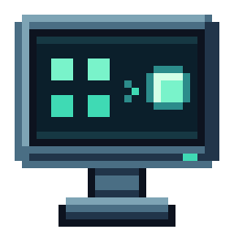

# Upscalp

Upscalp mirrors a high-resolution Windows display or game window to a **1080p display**. It can take a **3840 × 2160** source, downsample it on the GPU, and present the result in a full-screen window on a separate monitor or TV.

The app uses Windows Graphics Capture and Direct3D 11. It offers linear-light filtering, adjustable sharpening, a side-by-side filter comparison, and a 1080p PNG export. The default filter is Lanczos 3 with ringing control.

## Build and run

**Runtime requirements** include Windows 10 version 2004 or later, Direct3D 11, and an SDR display. To build, install Visual Studio 2022 with the C++ desktop tools, CMake 3.24 or later, and Windows SDK 10.0.26100 or later.

Run from the repository root in PowerShell.

```powershell
.\build.ps1 -Test
.\build\Release\Upscalp.exe
```

The core app runs without administrator privileges. Its current interface uses Turkish labels. The instructions below include the labels you will see.

## Mirror a 4K display

1. In Windows display settings, extend the desktop and set the source display to **3840 × 2160**. A physical display or an active virtual display works.
2. In Upscalp, select **Ekran · …** for that source. In **Çıktı ekranı / TV** (output display), choose a different screen, typically your 1080p TV.
3. Open the game in windowed mode and move it to the source display with **Win+Shift+Left/Right**. Use borderless mode and select 3840 × 2160 in the game if available.
4. Press **Ctrl+Alt+F7** to start or stop mirroring. Press **Ctrl+Alt+F10** to move the mouse between the game display and the control window.

The app also accepts a game window directly from the source list. Click **Yakalamayı başlat** (start capture) for a preview, or **Seçili ekranda başlat** (start on selected display) to request the selected window size and open the full-screen output. Window sizing and mouse forwarding depend on the game.

| Shortcut | Action |
| --- | --- |
| Ctrl+Alt+F7 | Start or stop mirroring |
| Ctrl+Alt+F10 | Switch mouse control between the source and Upscalp |
| Ctrl+Alt+F9 | Toggle full-screen output |
| Ctrl+Alt+F8 | Compare the selected filter with bilinear downsampling |
| Ctrl+Alt+End | Stop capture and restore window placement |

### Optional 4K virtual display

The Windows 11 x64 session launcher can temporarily attach a 3840 × 2160 display using **USB Mobile Monitor Virtual Display** by Amyuni Technologies Inc. It requires a Windows administrator prompt. Download the dependencies separately.

1. Extract the virtual display package so the INF, catalog, helper, and `x64` folder are under `build/_deps/amyuni-usbmmidd-v2/files/usbmmidd_v2/`. [Amyuni's USB Mobile Monitor virtual display package](https://www.amyuni.com/downloads/usbmmidd_v2.zip)
2. Extract the WDK package into `build/_deps/wdk/10.0.26100.6584/`, preserving its `c` directory. Install the Windows SDK 10.0.26100 signing tools for SignTool. [Microsoft WDK x64 10.0.26100.6584](https://www.nuget.org/packages/Microsoft.Windows.WDK.x64/10.0.26100.6584)
3. Copy the built executable to `out/Upscalp-4K.exe` and run `Upscalp-4K-Baslat.cmd`. To select an output by its Windows display name, run `.\tools\Start-Upscalp-4K.ps1 -OutputDisplay "Your display name"`. The launcher verifies the helper hash and driver signature.
4. Close Upscalp when finished. The launcher disconnects the display it attached and cleans up a driver installation it created for that session.

The repository also contains an **experimental IddCx driver** in `driver/`. To build its unsigned development package, run `.\tools\build-idd.ps1 -WdkRoot <path-to-WDK-c-directory>`.

## Image quality and frame timing

- The source size reports what Windows captured. The game's render scale, upscaler, and dynamic resolution determine the detail in that image.
- The comparison view downsamples the same source with bilinear filtering on the left and the selected filter on the right.
- **İşlenen** counts processed capture frames. **TV'ye sunulan** counts new capture frames accepted for presentation by DXGI. The game's frame counter measures the game's output.
- The full-screen output synchronizes to the target refresh. A steady 60 Hz output can repeat an image when the game misses an update. Rendering at a higher resolution increases GPU work.

## Tests

`.\build.ps1 -Test` runs 23 checks on the D3D11 WARP device. For a live check between two active displays, run `Upscalp.exe --monitor-smoke-test --source-display "Source name" --output-display "Output name" --report mirror-test.json` in an interactive Windows session.
